# Hound.exe

**English** · [Português](README.pt-BR.md) · [Website](https://saulofilho.github.io/hound-exe/)

A 1-bit action metroidvania starring the hound from
[scopehound](https://github.com/saulofilho/scopehound). The hound breaks into
an infected computer, hunts bugs with a blaster and sniffs through the whole
machine, folder by folder, until it reaches the kernel.


> **Status:** phase 1 (vertical slice) in progress · awaiting playtests · target platform: Steam

## The game in short

- **Side-view action with top-down rooms.** Most of the game is a side-view
  metroidvania. Going deep into a file or process flips the camera to a short,
  intense top-down room: a twin-stick arena or a timed puzzle.
- **Shoot fast, sniff smart.** Combat is quick and arcade-like. Sniffing slows
  time and reveals hidden passages, trails and enemy weak points.
- **The whole machine is one map.** Desktop, Memory, CPU, Network and Kernel
  are connected regions. New abilities reopen old areas.
- **The Collar.** The hound's gear is its collar. It projects the tools and
  enforces the scope: step outside it and the collar shocks you.

Feel references: *Gato Roboto*, *Not a Hero*, *Serious Sam: Bogus Detour* and
*Minit*. Character, map and art are our own.

## The demo: the Desktop region (0.2.1)

Eleven rooms and three wings. The door at the end of the Trash asks for **three
buried clues**; nothing shows them but sniffing, and each wing ends in one.

| Wing | What it teaches | At the end |
|---|---|---|
| Pictures, Gallery | hidden files: platforms that exist for 7 seconds after a sniff | quarantine, clue |
| Temp, Setup | temporary platforms over bad sectors | quarantine, dash chip, clue |
| System32, Drivers | gaps and lasers that need the dash | quarantine, clue |

- **Quarantines** lock you in with waves of bugs, including **Spam**, a winged
  envelope that shakes, shows its line and dives. Clearing one opens the
  shortcut back.
- **Folders** are doors: press down in front of one.
- **Bad sectors** cost 1 health and put the hound back on firm ground.
- **Secret backups**, one per exploration room (10), each make sniffing last longer.
- **Controls can be remapped** for keyboard and gamepad in OPTIONS > CONTROLS.
- **The door is a checkpoint:** dying in the top-down room or at the boss
  wakes you in the Trash, not at the foot of Drivers.
- **The ending shows your time**, deaths and secrets.

A bot that knows the route finishes, collecting every secret with every bug
alive, in about 5 and a half minutes. How long a first playthrough takes (the goal is 15 to 20) has not
been measured with people yet.

| Hidden files | Temporary platforms |
|---|---|
| 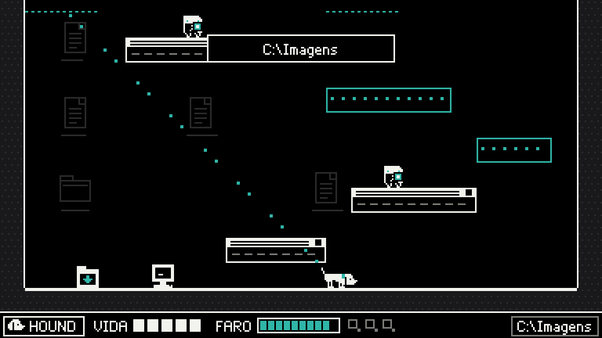 |  |
| **Quarantine** | **Folders** |
| 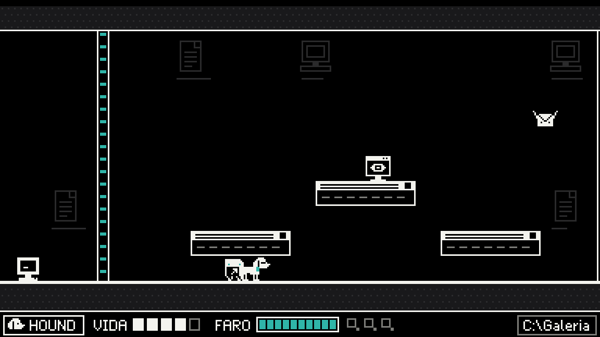 |  |
| **Remapping** | |
|  | |

## Screenshots

Captured from the game itself.

| Title | First room |
|---|---|
| 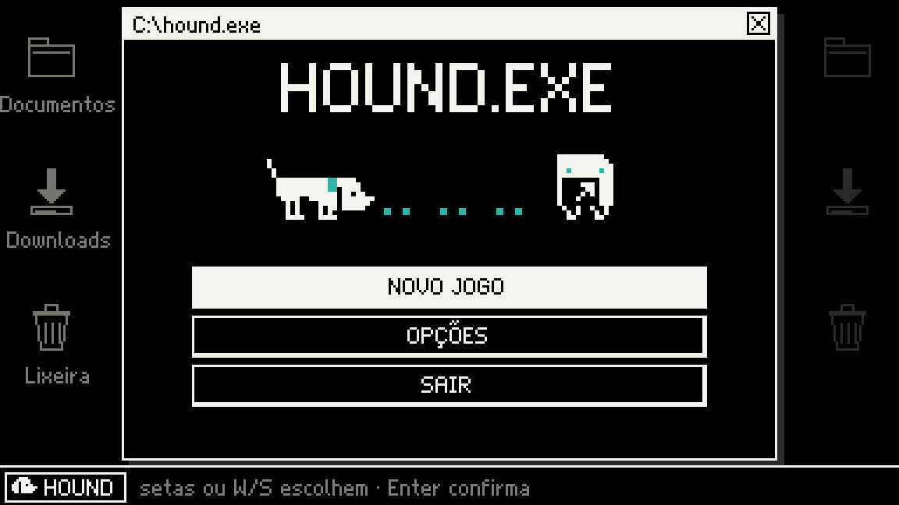 |  |
| **Pause** | **Blue screen** |
| 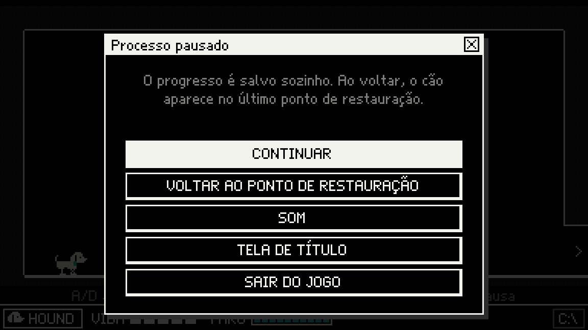 | 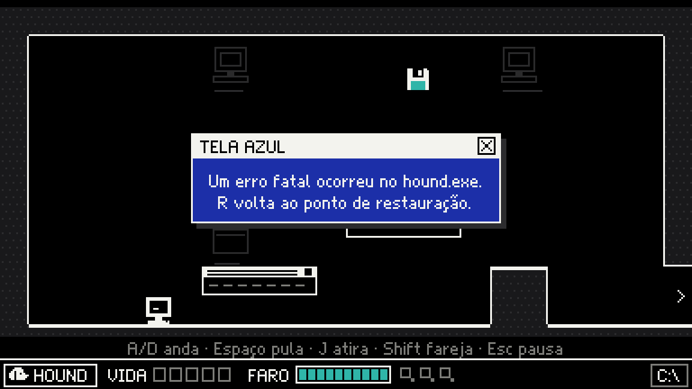 |

| Shooting bugs in Documentos | The laser only a dash gets through |
|---|---|
|  |  |
| **The dash chip in Setup** | **Sniffing in Lixeira** |
| 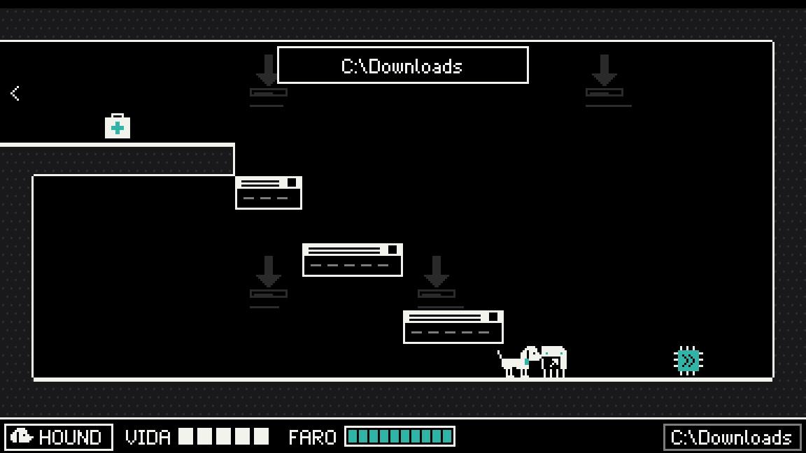 |  |
| **Explorer (Tab)** | **Top-down room** |
|  |  |

The hound starts **without the dash**; a laser in Documentos blocks the way to
Lixeira, and the dash chip waits past the Setup quarantine. **Sniffing** slows time and makes shots deal double damage, and it is
required: the fake wall that hides Lixeira's exit stays solid until it is
sniffed up close. A
**restore point** saves progress; dying sends you back to it. The door behind
the fake wall opens the **top-down room**: survive 45 seconds (sectors corrupt under your feet and
pop-ups shoot, so keep moving) and you return to
the region, where the same door now leads to the boss.

### Boss: o Arquivo Fantasma (the Ghost File)

| Hidden: shots pass through | Second phase: copies |
|---|---|
| 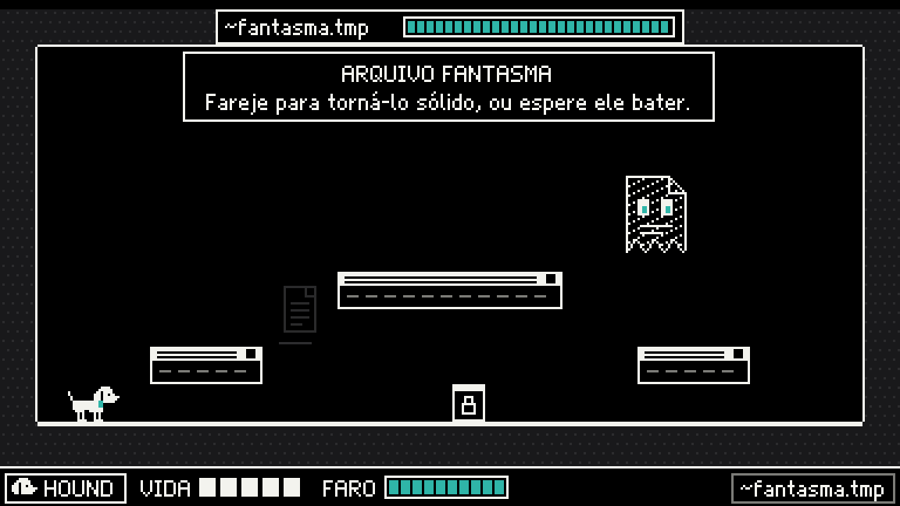 |  |
| **Sniffing shows the original** | **Stunned: open fire** |
|  | 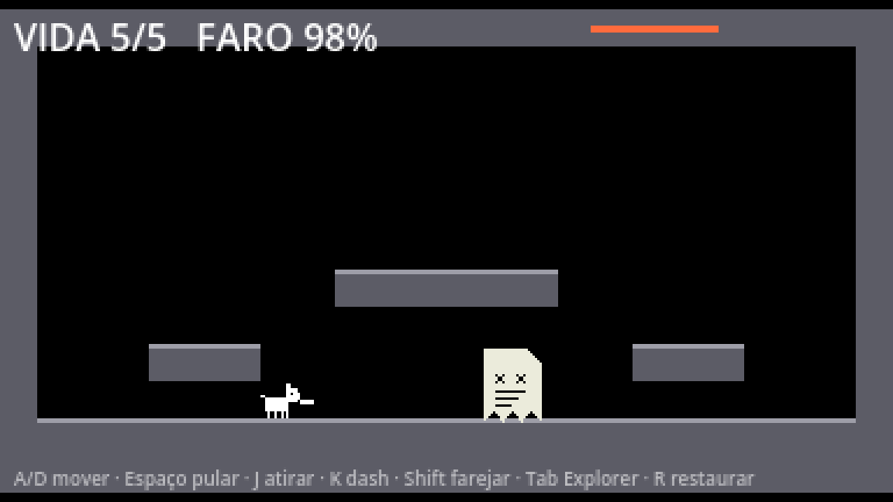 |

It floats and fires, then locks onto the hound's height, shows the line and
charges: jump it or dash through it. Hitting the wall stuns it, and that is the
window to shoot. Sniffing makes it solid at any time (double damage). At half
health it speeds up, fires in a spread and projects copies: from then on only
sniffing can hit the original. The charge takes 2 health, so standing still
loses. Dying sends you to the restore point and the boss recovers.

## Moodboard

The full moodboard is in [docs/moodboard.html](docs/moodboard.html) (open it in
a browser; it is animated). Highlights:

**The hound.** A silhouette readable at 16×16 px. It never speaks; posture,
ears and tail do the talking.

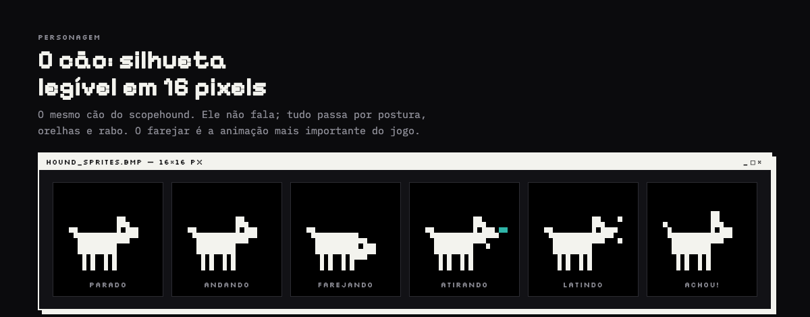

**Five worlds, five parts of the computer.** Black and white, plus a single
accent color per world, used only on what is playable.


**Bestiary.** Real software bugs become creatures, and the technical name
becomes the enemy's rule.

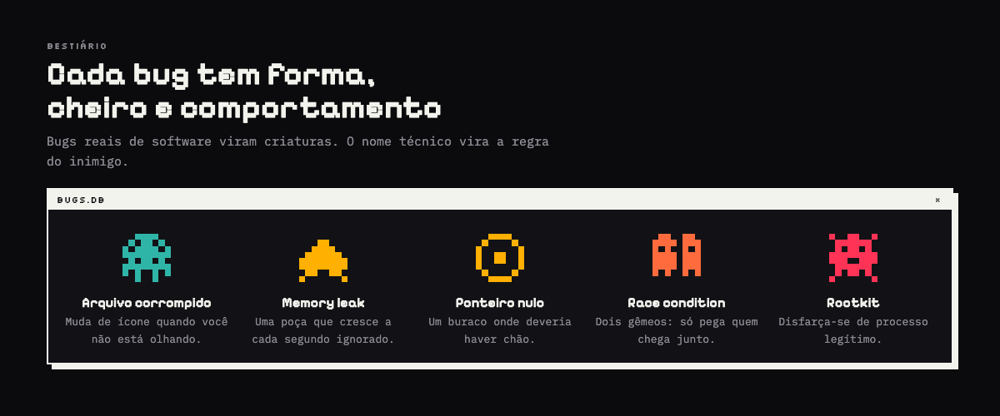

**HUD.** Sniff, budget and scope meters; alerts arrive as Windows 95 dialogs.

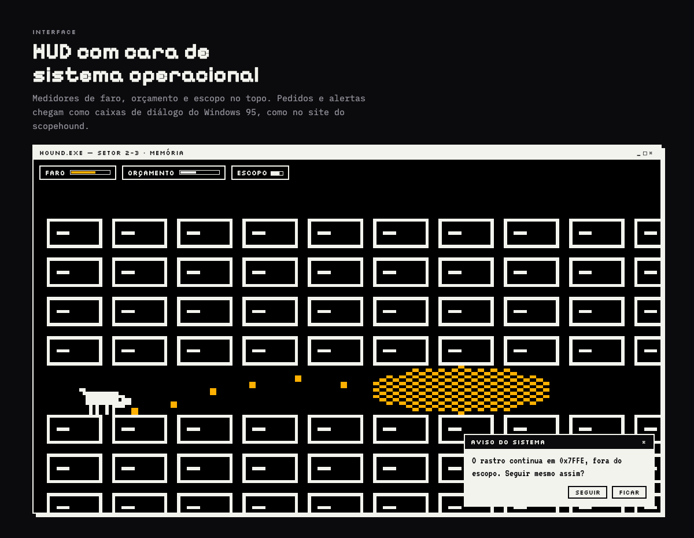

## Development plan

Estimates assume one person working part time (about 15 hours a week). Full
design in [docs/GDD.md](docs/GDD.md) (Portuguese).

| Phase | Length | Deliverable | Done when |
|---|---|---|---|
| **0. Pre-production** ← *now* | 3–4 weeks | GDD, moodboard, grey-box prototype | running, jumping and shooting feel good with no art |
| 1. Vertical slice | 3–4 months | Desktop region complete: 1 top-down room, 1 boss, final art and sound | 3 outside players finish the region unaided and want more |
| 2. Steam page | alongside phase 1 | "Coming soon" page, 30 s trailer, demo | page live, demo ready for Next Fest |
| 3. Production | 12–18 months | regions 2–5 and their bosses | game complete end to end |
| 4. Launch | — | Early Access or 1.0 | priced at US$ 10–15 |

### Phase 0 checklist

- [x] Game design document and moodboard
- [x] Godot 4 project, 384×216 base resolution with integer scaling
- [x] Hound controller: run, jump (coyote time, jump buffer, variable height), dash
- [x] Blaster with 3 aim directions and recoil
- [x] Two bugs: a patroller and a turret that telegraphs its shots
- [x] Game feel: screen shake, hitstop, hit flash, shards; "blue screen" on death
- [x] Automated smoke test
- [x] Sniff: slow motion, energy meter, fake wall, trail, weak point (double damage)
- [x] Door into a top-down arena: 45 seconds of waves, twin-stick aiming
- [ ] Playtest with 5 people and tune the numbers *(deferred to the end)*

### Phase 1 checklist (vertical slice: Desktop region)

- [x] Connected rooms built from ASCII maps, with exits at the screen edges
- [x] Game state that survives room changes (health, abilities, items taken)
- [x] First ability gate: dash chip in Setup, laser barrier in Documentos
- [x] Restore points; death returns you to the last one
- [x] Explorer map (Tab) of visited rooms
- [x] Top-down room returns to the region once cleared
- [x] Region boss: *o Arquivo Fantasma*
- [x] Windows 95 HUD and pixel font
- [x] 1-bit sprites, tiles and wallpaper
- [x] Sound effects and music (original chiptune, volume settings)
- [x] Title screen, pause menu, save to disk
- [x] Expanded region: 3 wings, clues, quarantines, shortcuts, secrets, Spam
- [ ] Measure a first playthrough with people (goal: 15 to 20 minutes)

### Phase 2 checklist (Steam page and demo)

- [x] English and Brazilian Portuguese
- [x] Any controller, with prompts that follow the input in use
- [x] Options: volume, language, fullscreen, screen shake, remapping; credits and licenses
- [x] An ending for the demo
- [x] Windows, Linux and macOS export; SteamPipe scripts
- [x] Store art, screenshots, gameplay trailer and store text
- [x] English website for GitHub Pages
- [x] Trailer re-encoded for Steam (19,734 kbps, checked by the script)
- [x] Submission kit and screen-by-screen guide ([steam/ENVIO.md](steam/ENVIO.md), Portuguese)
- [ ] Decide whether the repository stays public before selling
- [ ] Swap the website's "Planned for Steam" for a wishlist button once the page is live
- [x] First green CI run on Windows and Linux (`.github/workflows/tests.yml`)
- [ ] Run on real Windows, Linux, Steam Deck and a physical gamepad
- [ ] macOS notarization
- [x] Name decided: Hound.exe ([screen](steam/NOME.md), Portuguese)
- [ ] Trademark lawyer check, before the store page review locks the name
- [ ] Steamworks account, store page review, demo review

## Running the prototype

1. Install Godot 4.7.2 (`brew install --cask godot` on macOS).
2. Import the project once after cloning (the game will not start without
   this):

   ```bash
   godot --headless --path . --import
   ```

3. Run the game:

   ```bash
   godot --path .
   ```

   Or open the project in the editor with `godot -e --path .` and press **F5**.

| Action | Keyboard | Gamepad |
|---|---|---|
| Move | A/D or arrows | left stick |
| Enter a folder | S or down arrow | left stick or D-pad down |
| Aim up | W (with A/D: diagonal) | left stick up |
| Jump | Space or Z | A |
| Shoot (hold) | J or X | X |
| Dash | K or C | B |
| Sniff (hold) | Shift or L | left trigger |
| Explorer map | Tab | Back |
| Aim in the top-down room | mouse | right stick |
| Pause | Esc | Start |
| Back to restore point | hold R (or the pause menu); a tap on the blue screen | pause menu; Start on the blue screen |

These are the defaults: everything but pause, restart and top-down aiming can
be remapped in OPTIONS > CONTROLS.

### Tests and tools

`python3 tools/run_tests.py` runs everything below in a throwaway user folder
(about 6 minutes). The same command runs on Windows and Linux in GitHub
Actions, which also exports both builds and checks that they open on them.
Pass suite names to run only those: `python3 tools/run_tests.py save steam`.

```bash
# playtest counters: clock, deaths, restarts, old and broken saves (real time)
godot --headless --path . -s tests/stats.gd

# the whole game from NEW GAME to the ending, inputs only: every clue and
# secret, every bug alive, real quarantines, arena and boss (needs python3;
# `-- 16` plays another variation)
godot --headless --fixed-fps 60 --path . -s tests/campaign.gd

# proof over the maps: paths exist, shortcuts don't, no room traps the hound
# (about a minute; run it after editing rooms.gd)
python3 tools/check_rooms.py

# region rules (blocks, clues, quarantine, shortcuts) and remapping
godot --headless --fixed-fps 60 --path . -s tests/region.gd

# rules and state, jumping between points by teleport (29 checks)
godot --headless --path . -s tests/smoke.gd

# Documentos, Downloads and Lixeira with inputs only, plus every laser distance
godot --headless --path . -s tests/route.gd

# art: font coverage, text widths and sprite sheets
godot --headless --path . -s tests/art.gd

# audio: every event, saved volumes and the recorded mixer output
# (about 80 seconds; needs real time, so no --fixed-fps)
godot --headless --path . -s tests/audio.gd

# save, title and pause across real processes, including a forced kill
# (uses its own user://test_* files)
godot --headless --fixed-fps 60 --path . -s tests/save.gd

# attempts to break the game: past bugs, finishing without sniffing, winning
# without moving (every free arena cell, 408 boss fights; takes a few minutes)
godot --headless --fixed-fps 60 --path . -s tests/exploits.gd

# one run from Lixeira to the ending, inputs only
godot --headless --fixed-fps 60 --path . -s tests/finish.gd

# the full 45 seconds of the top-down room, inputs only, 10 seeds
godot --headless --fixed-fps 60 --path . -s tests/arena.gd

# boss fights, inputs only: 5 strategies, 6 start timings
godot --headless --fixed-fps 60 --path . -s tests/boss.gd

# regenerates the gameplay screenshots in docs/img/ (needs a window)
godot --path . -s tools/capture.gd
```

## Saving

The game saves by itself on entering a room, creating a restore point, picking
up an item, clearing the top-down room and beating the boss. Continuing works
like dying: you keep your progress and wake at the last restore point with full
health.

| System | Save folder |
|---|---|
| macOS | `~/Library/Application Support/HoundExe/` |
| Windows | `%APPDATA%\HoundExe\` |
| Linux | `~/.local/share/HoundExe/` |

`save.json` is the current save and `save.json.bak` the one before it, used
when the main file is missing or unreadable. Only the title screen turns saving
on: opening `main.tscn` directly (F6 in the editor), tests and tools never
write to your save.

## Playtests

`save.json` also counts play time, deaths and restarts per room, when each
milestone happened and whether frames dropped below 30 fps. It holds nothing
that identifies the player and the game never sends it. Testers send the file
by hand (`builds/testers/LEIA-ME-TESTE.txt`, in both languages) and

```bash
python3 tools/playtest_report.py saves/
```

turns those files into the numbers. The procedure is in
[docs/PLAYTEST.md](docs/PLAYTEST.md) (Portuguese).

## Sound

All audio is original and synthesized by
[`tools/make_audio.py`](tools/make_audio.py); the scores are plain text in
that file. After editing it:

```bash
python3 tools/make_audio.py
godot --headless --path . --import
```

- **Music:** title, Desktop, top-down room and boss. The Desktop track gains a
  tension layer as bugs get close; the boss gains one in its second phase.
- **Sniffing:** muffles the music and pings the nearest scent, faster and
  higher as you get closer. Each scent and each bug has its own timbre.
- **Volume:** OPTIONS in the title and pause menus, stored next to the save in
  `save.settings.json`.

## Art

All art, including the pixel font with Portuguese accents, is original and
drawn as text in [`tools/make_art.py`](tools/make_art.py). After editing it:

```bash
python3 tools/make_art.py
godot --headless --path . --import
```

White, black and one accent per region (teal for the Desktop), used only on
what is playable. The blue screen is the one deliberate exception. Scenery is
drawn from the same ASCII maps as the collisions.

## Builds and Steam

```bash
tools/build.sh          # Windows, Linux and macOS into builds/
tools/make_trailer.sh   # gameplay trailer (macOS only)
python3 tools/steam_kit.py   # everything to upload to Steamworks, validated (macOS)
tools/make_promo.sh     # 33 s promo video, 16:9 and 9:16 (macOS only)
```

Building needs the official Godot 4.7.2 export templates. Everything about
publishing (requirements, what is still blocking, depots, Cloud, content and AI
survey) is in [steam/PUBLICAR.md](steam/PUBLICAR.md) (Portuguese).

```bash
# Steam and Steam Deck criteria: languages, prompts, controllers, options, assets
godot --headless --fixed-fps 60 --path . -s tests/steam.gd
```

## Website

<https://saulofilho.github.io/hound-exe/> is served by GitHub Pages from the
root of `main`: `index.html`, `404.html` and `site/`. `_config.yml` keeps code,
tests, the design document and publishing notes off that address.

```bash
python3 tools/make_site.py   # font, sprites, screenshots, social image, video
python3 -m http.server 8847 --bind 127.0.0.1   # preview at localhost:8847
```

Regenerate after changing the art, the store screenshots or the promo video.
The site's copy is hand-written in `index.html` and, like the store text, must
only promise what is in the build. Holding sniff on the page reveals three
clues, as in the game.

## Project layout

```
project.godot     settings (384×216, integer scaling, crisp pixels)
title.tscn        title screen (the game starts here)
main.tscn         side-view room (builds whichever room is current)
arena.tscn        top-down room
scripts/
├── game.gd       autoload "Game": current room, health, abilities, restore point
├── save_file.gd  validated JSON save with a backup
├── title.gd      title screen; turns saving on
├── pause_menu.gd pause menu
├── menu.gd       option list for keyboard, gamepad and mouse
├── sound.gd      autoload "Sound": effects, layered music, volume
├── art.gd        palette, pixel text, window frame
├── room_art.gd   walls, window platforms and wallpaper from the map
├── hud.gd        taskbar HUD and boss bar
├── dialog_box.gd toasts and dialogs
├── options.gd    autoload "Options": language, fullscreen, shake, active input
├── controls.gd   remappable keys and buttons, and their on-screen names
├── special_block.gd hidden and temporary platforms
├── quarantine.gd locking fight with waves
├── spam.gd       flying bug that dives
├── run_stats.gd  per-run time and death counters kept in the save
├── texts.gd      every visible string, in Portuguese and English
├── rooms.gd      the Desktop region's rooms as ASCII maps, and how they link
├── stage.gd      shared base: controls, screen shake, hitstop, HUD, toasts
├── main.gd       room builder: exits, items, laser, restore point, door, Explorer
├── arena.gd      top-down room: bug waves and the 45-second timer
├── player.gd     the hound (side view): movement, dash, shooting, sniff
├── top_hound.gd  the hound (top-down): 8-way movement, twin-stick aim
├── bullet.gd     hound and bug projectiles
├── ghost_file.gd the region boss: states, charge, copies
├── enemy.gd      bug base: health, hit flash, knockback, shards
├── walker.gd     patrolling bug
├── turret.gd     shooting bug
└── chaser.gd     swarming bug (and bad_sector.gd, the corrupted floor) (top-down room)
tests/            campaign, region, smoke, route, finish, exploits, arena, boss, save, audio, art and Steam tests
audio/            generated WAV files
art/              generated sprite sheets and font
tools/make_art.py sprites and font, drawn as text
tools/build.sh    exports every platform
steam/            store assets, texts and publishing guide
tools/make_audio.py  synthesizer and scores
tools/run_tests.py every test, in a throwaway user folder
tools/playtest_report.py turns testers' saves into numbers
.github/workflows tests and boot checks on Windows and Linux
index.html, site/ the website
tools/make_site.py generates the website's media
tools/steam_kit.py the Steamworks submission folder
tools/check_rooms.py reachability proof over the maps
tools/capture.gd  screenshot capture
docs/             GDD, moodboard and images
```

To change the rooms, edit `scripts/rooms.gd`. Map legend:
`#` wall · `F` fake wall · `L` laser · `P` start · `R` restore point ·
`A` dash chip · `B` boss · `E` exit that opens once the boss falls · `H` health patch · `D` door to the top-down room ·
`w` walking bug · `t` turret · `s` Spam · `o` hidden file · `T` temporary
platform · `^` bad sector · `Q` quarantine gate · `S` secret backup ·
`V` buried clue · `0`-`9` folder. `links` say where each edge opening leads
(rows are local to each room), `doors` where each folder leads and `fight`
describes the quarantine. Run `python3 tools/check_rooms.py` afterwards.
