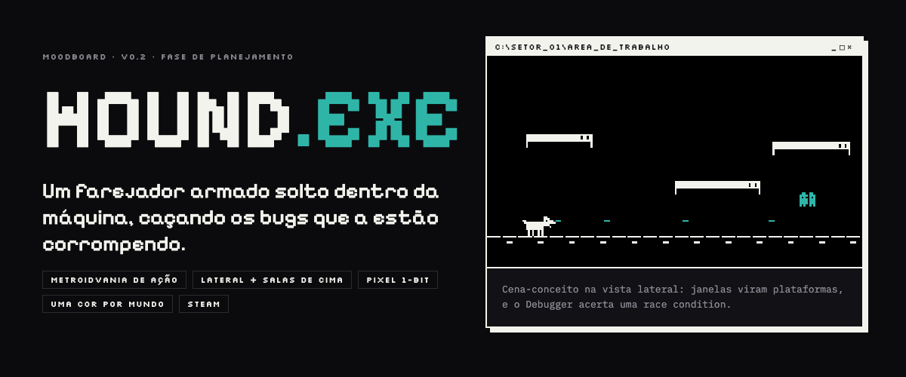
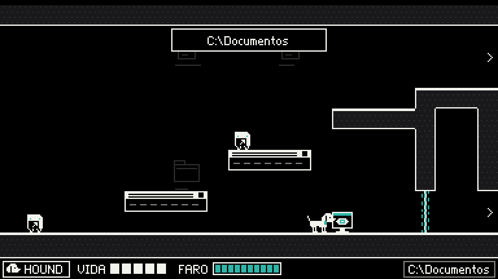
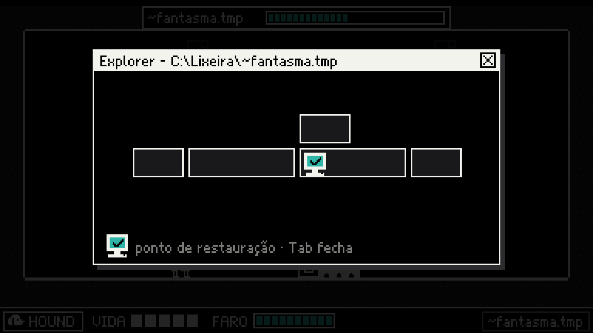
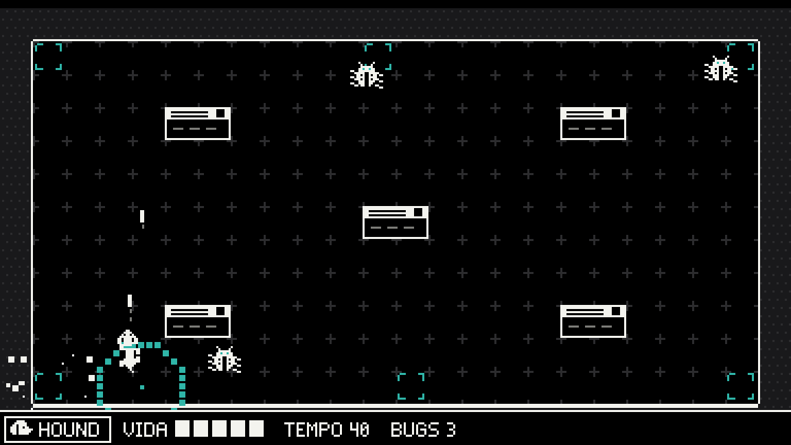
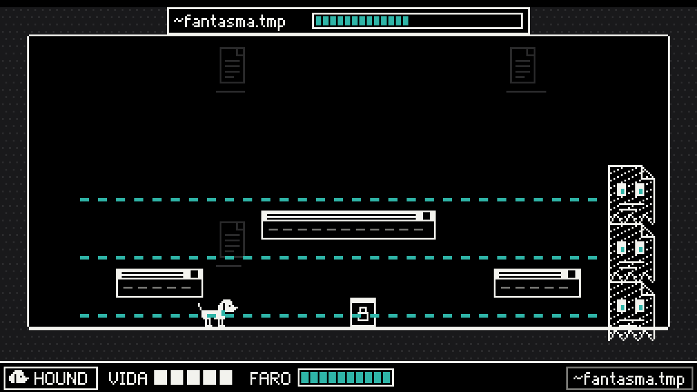
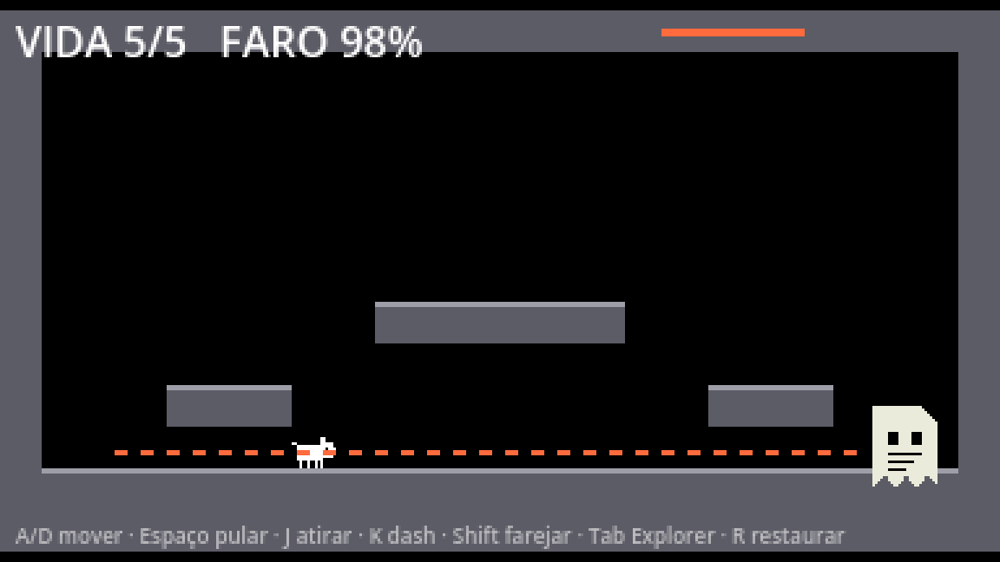

# Hound.exe

**English** · [Português](README.pt-BR.md)

A 1-bit action metroidvania starring the hound from
[scopehound](https://github.com/saulofilho/scopehound). The hound breaks into
an infected computer, hunts bugs with a blaster and sniffs through the whole
machine, folder by folder, until it reaches the kernel. Working title.



> **Status:** phase 1 (vertical slice) in progress · grey-box art · target platform: Steam

## The game in short

- **Side-view action with top-down rooms.** Most of the game is a side-view
  metroidvania. Going deep into a file or process flips the camera to a short,
  intense top-down room: a twin-stick arena or a timed puzzle.
- **Shoot fast, sniff smart.** Combat is quick and arcade-like. Sniffing slows
  time and reveals hidden passages, trails and enemy weak points.
- **The whole machine is one map.** Desktop, Memory, CPU, Network and Kernel
  are connected regions. New abilities reopen old areas.
- **The Collar.** The hound's gear is its collar. It projects the tools and
  enforces the scope: step outside it and the collar shocks you.

Feel references: *Gato Roboto*, *Not a Hero*, *Serious Sam: Bogus Detour* and
*Minit*. Character, map and art are our own.

## Prototype screenshots

Grey-box build, captured from the game itself.

| Shooting bugs in Documentos | The laser only a dash gets through |
|---|---|
|  |  |
| **The dash chip in Downloads** | **Sniffing in Lixeira** |
|  |  |
| **Explorer (Tab)** | **Top-down room** |
|  |  |

The Desktop region has four connected rooms and a boss room. The hound starts **without the
dash**; a laser in Documentos blocks the way to Lixeira, and the dash chip
waits at the end of the Downloads branch. **Sniffing** slows time, reveals the
fake wall that hides Lixeira's exit and makes shots deal double damage. A
**restore point** saves progress; dying sends you back to it. The door behind
the fake wall opens the **top-down room**: survive 45 seconds and you return to
the region, where the same door now leads to the boss.

### Boss: o Arquivo Fantasma (the Ghost File)

| Hidden: shots pass through | Second phase: copies |
|---|---|
|  |  |
| **Sniffing shows the original** | **Stunned: open fire** |
|  |  |

It floats and fires, then locks onto the hound's height, shows the line and
charges: jump it or dash through it. Hitting the wall stuns it, and that is the
window to shoot. Sniffing makes it solid at any time (double damage). At half
health it speeds up, fires in a spread and projects copies that only sniffing
clears. Dying sends you to the restore point and the boss recovers.

## Moodboard

The full moodboard is in [docs/moodboard.html](docs/moodboard.html) (open it in
a browser; it is animated). Highlights:

**The hound.** A silhouette readable at 16×16 px. It never speaks; posture,
ears and tail do the talking.


**Five worlds, five parts of the computer.** Black and white, plus a single
accent color per world, used only on what is playable.


**Bestiary.** Real software bugs become creatures, and the technical name
becomes the enemy's rule.


**HUD.** Sniff, budget and scope meters; alerts arrive as Windows 95 dialogs.


## Development plan

Estimates assume one person working part time (about 15 hours a week). Full
design in [docs/GDD.md](docs/GDD.md) (Portuguese).

| Phase | Length | Deliverable | Done when |
|---|---|---|---|
| **0. Pre-production** ← *now* | 3–4 weeks | GDD, moodboard, grey-box prototype | running, jumping and shooting feel good with no art |
| 1. Vertical slice | 3–4 months | Desktop region complete: 1 top-down room, 1 boss, final art and sound | 3 outside players finish the region unaided and want more |
| 2. Steam page | alongside phase 1 | "Coming soon" page, 30 s trailer, demo | page live, demo ready for Next Fest |
| 3. Production | 12–18 months | regions 2–5 and their bosses | game complete end to end |
| 4. Launch | — | Early Access or 1.0 | priced at US$ 10–15 |

### Phase 0 checklist

- [x] Game design document and moodboard
- [x] Godot 4 project, 384×216 base resolution with integer scaling
- [x] Hound controller: run, jump (coyote time, jump buffer, variable height), dash
- [x] Blaster with 3 aim directions and recoil
- [x] Two bugs: a patroller and a turret that telegraphs its shots
- [x] Game feel: screen shake, hitstop, hit flash, shards; "blue screen" on death
- [x] Automated smoke test
- [x] Sniff: slow motion, energy meter, fake wall, trail, weak point (double damage)
- [x] Door into a top-down arena: 45 seconds of waves, twin-stick aiming
- [ ] Playtest with 5 people and tune the numbers *(deferred to the end)*

### Phase 1 checklist (vertical slice: Desktop region)

- [x] Connected rooms built from ASCII maps, with exits at the screen edges
- [x] Game state that survives room changes (health, abilities, items taken)
- [x] First ability gate: dash chip in Downloads, laser barrier in Documentos
- [x] Restore points; death returns you to the last one
- [x] Explorer map (Tab) of visited rooms
- [x] Top-down room returns to the region once cleared
- [x] Region boss: *o Arquivo Fantasma* (placeholder art)
- [ ] Windows 95 HUD and pixel fonts
- [ ] Final 1-bit sprites and tiles
- [x] Sound effects and music (original chiptune, volume settings)
- [x] Title screen, pause menu, save to disk

## Running the prototype

1. Install Godot 4.3 or newer (`brew install --cask godot` on macOS).
2. Import the project once after cloning (the game will not start without
   this):

   ```bash
   godot --headless --path . --import
   ```

3. Run the game:

   ```bash
   godot --path .
   ```

   Or open the project in the editor with `godot -e --path .` and press **F5**.

| Action | Keyboard | Gamepad |
|---|---|---|
| Move | A/D or arrows | left stick |
| Aim up | W (with A/D: diagonal) | left stick up |
| Jump | Space or Z | A |
| Shoot (hold) | J or X | X |
| Dash | K or C | B |
| Sniff (hold) | Shift or L | left trigger |
| Explorer map | Tab | Back |
| Aim in the top-down room | mouse | right stick |
| Pause | Esc | Start |
| Back to restore point | R (or the pause menu) | pause menu; Start on the blue screen |

### Tests and tools

```bash
# rules and state, jumping between points by teleport (29 checks)
godot --headless --path . -s tests/smoke.gd

# start to top-down room door with inputs only (bugs removed), plus laser distances
godot --headless --path . -s tests/route.gd

# audio: every event, saved volumes and the recorded mixer output
# (about 80 seconds; needs real time, so no --fixed-fps)
godot --headless --path . -s tests/audio.gd

# save, title and pause across real processes, including a forced kill
# (uses its own user://test_* files)
godot --headless --fixed-fps 60 --path . -s tests/save.gd

# the full 45 seconds of the top-down room, inputs only, 10 seeds
godot --headless --fixed-fps 60 --path . -s tests/arena.gd

# boss fights, inputs only: 5 strategies, 6 start timings
godot --headless --fixed-fps 60 --path . -s tests/boss.gd

# regenerates the gameplay screenshots in docs/img/ (needs a window)
godot --path . -s tools/capture.gd
```

## Saving

The game saves by itself on entering a room, creating a restore point, picking
up an item, clearing the top-down room and beating the boss. Continuing works
like dying: you keep your progress and wake at the last restore point with full
health.

| System | Save folder |
|---|---|
| macOS | `~/Library/Application Support/HoundExe/` |
| Windows | `%APPDATA%\HoundExe\` |
| Linux | `~/.local/share/HoundExe/` |

`save.json` is the current save and `save.json.bak` the one before it, used
when the main file is missing or unreadable. Only the title screen turns saving
on: opening `main.tscn` directly (F6 in the editor), tests and tools never
write to your save.

## Sound

All audio is original and synthesized by
[`tools/make_audio.py`](tools/make_audio.py); the scores are plain text in
that file. After editing it:

```bash
python3 tools/make_audio.py
godot --headless --path . --import
```

- **Music:** title, Desktop, top-down room and boss. The Desktop track gains a
  tension layer as bugs get close; the boss gains one in its second phase.
- **Sniffing:** muffles the music and pings the nearest scent, faster and
  higher as you get closer. Each scent and each bug has its own timbre.
- **Volume:** SOM in the title and pause menus, stored next to the save in
  `save.settings.json`.

## Project layout

```
project.godot     settings (384×216, integer scaling, crisp pixels)
title.tscn        title screen (the game starts here)
main.tscn         side-view room (builds whichever room is current)
arena.tscn        top-down room
scripts/
├── game.gd       autoload "Game": current room, health, abilities, restore point
├── save_file.gd  validated JSON save with a backup
├── title.gd      title screen; turns saving on
├── pause_menu.gd pause menu
├── menu.gd       option list for keyboard, gamepad and mouse
├── sound.gd      autoload "Sound": effects, layered music, volume
├── rooms.gd      the Desktop region's rooms as ASCII maps, and how they link
├── stage.gd      shared base: controls, screen shake, hitstop, HUD, toasts
├── main.gd       room builder: exits, items, laser, restore point, door, Explorer
├── arena.gd      top-down room: bug waves and the 45-second timer
├── player.gd     the hound (side view): movement, dash, shooting, sniff
├── top_hound.gd  the hound (top-down): 8-way movement, twin-stick aim
├── bullet.gd     hound and bug projectiles
├── ghost_file.gd the region boss: states, charge, copies
├── enemy.gd      bug base: health, hit flash, knockback, shards
├── walker.gd     patrolling bug
├── turret.gd     shooting bug
└── chaser.gd     swarming bug (top-down room)
tests/            smoke, route, arena, boss, save and audio tests
audio/            generated WAV files
tools/make_audio.py  synthesizer and scores
tools/capture.gd  screenshot capture
docs/             GDD, moodboard and images
```

To change the rooms, edit `scripts/rooms.gd`. Map legend:
`#` wall · `F` fake wall · `L` laser · `P` start · `R` restore point ·
`A` dash chip · `B` boss · `E` exit that opens once the boss falls · `H` health patch · `D` door to the top-down room ·
`w` walking bug · `t` turret. Each room's `links` say where every edge opening
leads; the rows line up between rooms.
