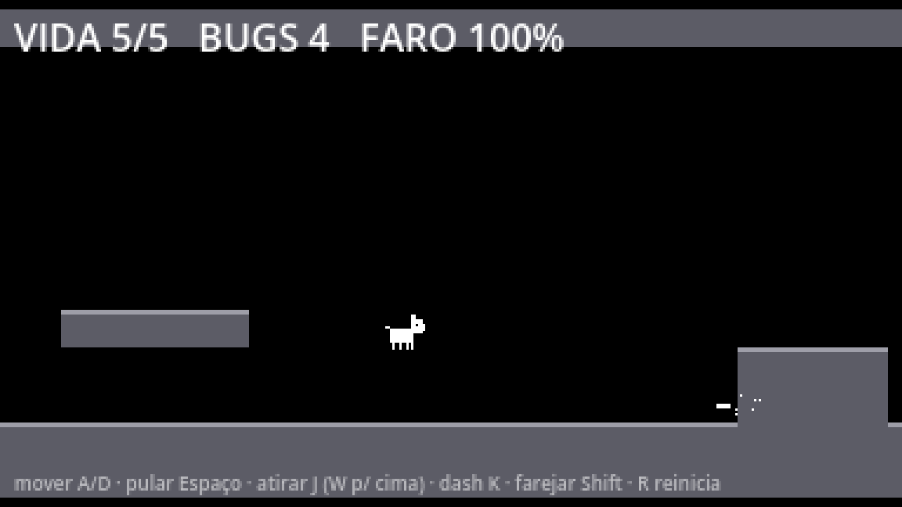
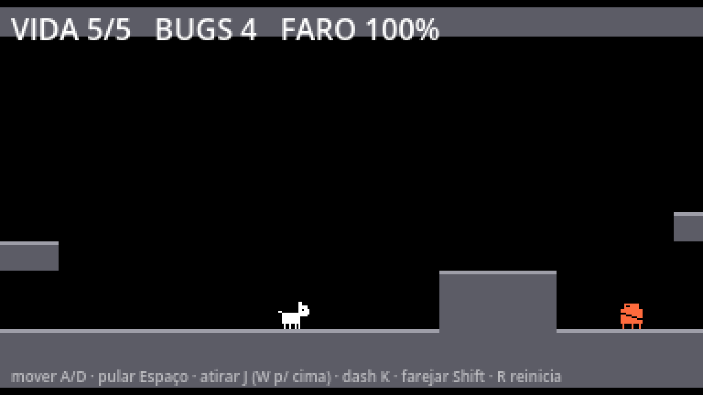
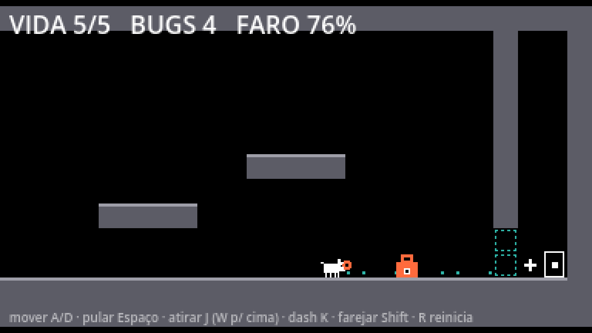
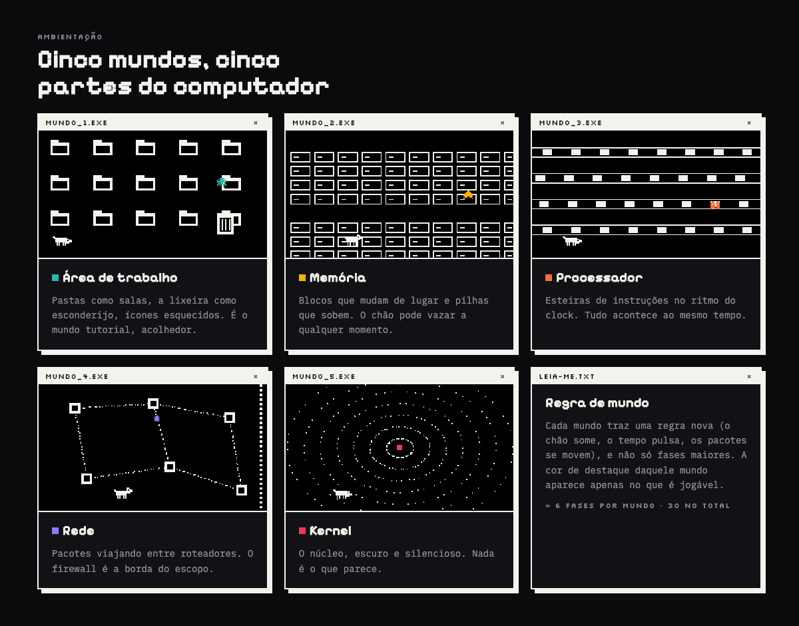

# Hound.exe

**English** · [Português](README.pt-BR.md)

A 1-bit action metroidvania starring the hound from
[scopehound](https://github.com/saulofilho/scopehound). The hound breaks into
an infected computer, hunts bugs with a blaster and sniffs through the whole
machine, folder by folder, until it reaches the kernel. Working title.


> **Status:** phase 0 (prototype) · grey-box art · target platform: Steam

## The game in short

- **Side-view action with top-down rooms.** Most of the game is a side-view
  metroidvania. Going deep into a file or process flips the camera to a short,
  intense top-down room: a twin-stick arena or a timed puzzle.
- **Shoot fast, sniff smart.** Combat is quick and arcade-like. Sniffing slows
  time and reveals hidden passages, trails and enemy weak points.
- **The whole machine is one map.** Desktop, Memory, CPU, Network and Kernel
  are connected regions. New abilities reopen old areas.
- **The Collar.** The hound's gear is its collar. It projects the tools and
  enforces the scope: step outside it and the collar shocks you.

Feel references: *Gato Roboto*, *Not a Hero*, *Serious Sam: Bogus Detour* and
*Minit*. Character, map and art are our own.

## Prototype screenshots

Grey-box build from phase 0, captured from the game itself.

| Shooting | Bugs and turret |
|---|---|
|  |  |
| **Sniffing** | **Top-down room** |
|  |  |

While **sniffing**, time slows to half speed, the fake wall that hides the
exit shows up, a trail points to it, and the bugs' weak point blinks: shots
deal double damage. The door behind the wall opens the **top-down room**:
survive 45 seconds of bug waves.

## Moodboard

The full moodboard is in [docs/moodboard.html](docs/moodboard.html) (open it in
a browser; it is animated). Highlights:

**The hound.** A silhouette readable at 16×16 px. It never speaks; posture,
ears and tail do the talking.


**Five worlds, five parts of the computer.** Black and white, plus a single
accent color per world, used only on what is playable.



**Bestiary.** Real software bugs become creatures, and the technical name
becomes the enemy's rule.


**HUD.** Sniff, budget and scope meters; alerts arrive as Windows 95 dialogs.


## Development plan

Estimates assume one person working part time (about 15 hours a week). Full
design in [docs/GDD.md](docs/GDD.md) (Portuguese).

| Phase | Length | Deliverable | Done when |
|---|---|---|---|
| **0. Pre-production** ← *now* | 3–4 weeks | GDD, moodboard, grey-box prototype | running, jumping and shooting feel good with no art |
| 1. Vertical slice | 3–4 months | Desktop region complete: 1 top-down room, 1 boss, final art and sound | 3 outside players finish the region unaided and want more |
| 2. Steam page | alongside phase 1 | "Coming soon" page, 30 s trailer, demo | page live, demo ready for Next Fest |
| 3. Production | 12–18 months | regions 2–5 and their bosses | game complete end to end |
| 4. Launch | — | Early Access or 1.0 | priced at US$ 10–15 |

### Phase 0 checklist

- [x] Game design document and moodboard
- [x] Godot 4 project, 384×216 base resolution with integer scaling
- [x] Hound controller: run, jump (coyote time, jump buffer, variable height), dash
- [x] Blaster with 3 aim directions and recoil
- [x] Two bugs: a patroller and a turret that telegraphs its shots
- [x] Game feel: screen shake, hitstop, hit flash, shards; "blue screen" on death
- [x] Automated smoke test
- [x] Sniff: slow motion, energy meter, fake wall, trail, weak point (double damage)
- [x] Door into a top-down arena: 45 seconds of waves, twin-stick aiming
- [ ] Playtest with 5 people and tune the numbers

## Running the prototype

1. Install Godot 4.3 or newer (`brew install --cask godot` on macOS).
2. Run the game:

   ```bash
   godot --path .
   ```

   Or open the project in the editor with `godot -e --path .` and press **F5**.

| Action | Keyboard | Gamepad |
|---|---|---|
| Move | A/D or arrows | left stick |
| Aim up | W (with A/D: diagonal) | left stick up |
| Jump | Space or Z | A |
| Shoot (hold) | J or X | X |
| Dash | K or C | B |
| Sniff (hold) | Shift or L | left trigger |
| Aim in the top-down room | mouse | right stick |
| Restart | R | Start |

### Tests and tools

```bash
# plays the corridor and the top-down room on its own (15 checks: movement,
# shooting, sniff, fake wall, door, waves, timer and the win screen)
godot --headless --path . -s tests/smoke.gd

# regenerates the gameplay screenshots in docs/img/ (needs a window)
godot --path . -s tools/capture.gd
```

## Project layout

```
project.godot     settings (384×216, integer scaling, crisp pixels)
main.tscn         side-view corridor
arena.tscn        top-down room
scripts/
├── stage.gd      shared base: controls, screen shake, hitstop, HUD, restart
├── main.gd       corridor from an ASCII map; fake wall, health patch, door
├── arena.gd      top-down room: bug waves and the 45-second timer
├── player.gd     the hound (side view): movement, dash, shooting, sniff
├── top_hound.gd  the hound (top-down): 8-way movement, twin-stick aim
├── bullet.gd     hound and bug projectiles
├── enemy.gd      bug base: health, hit flash, knockback, shards
├── walker.gd     patrolling bug
├── turret.gd     shooting bug
└── chaser.gd     swarming bug (top-down room)
tests/smoke.gd    automated smoke test
tools/capture.gd  screenshot capture
docs/             GDD, moodboard and images
```

To change the corridor, edit `MAP` in `scripts/main.gd`:
`#` wall · `F` fake wall · `P` hound · `w` walking bug · `t` turret ·
`H` health patch · `D` door to the top-down room.
