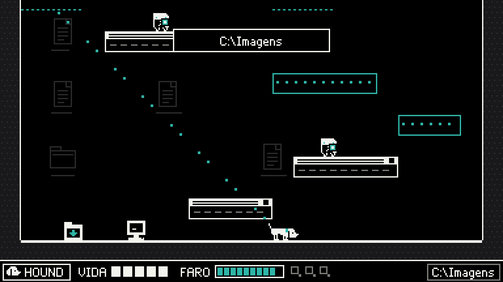
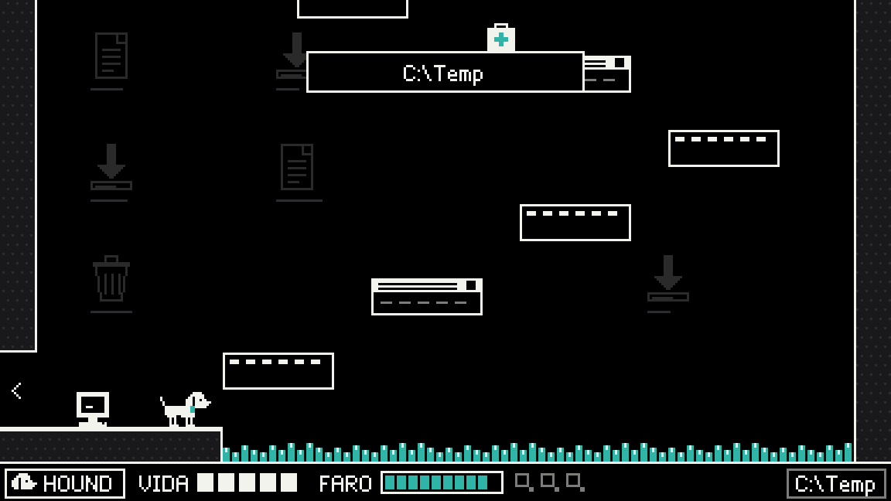
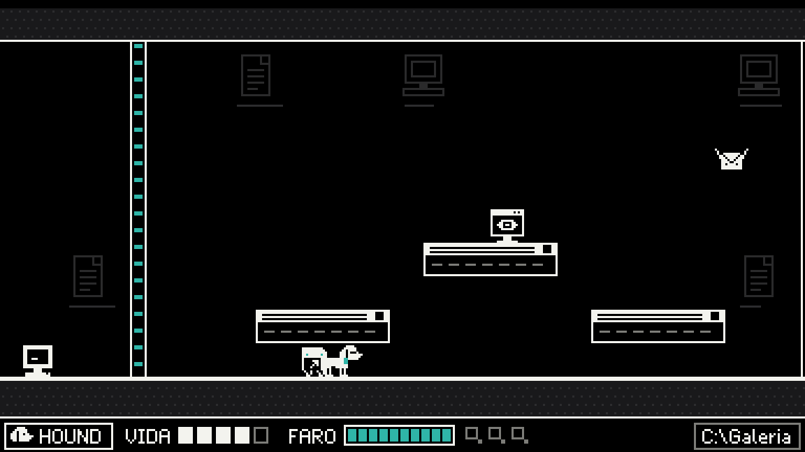
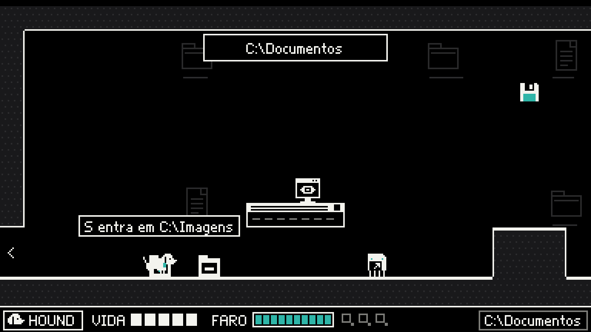
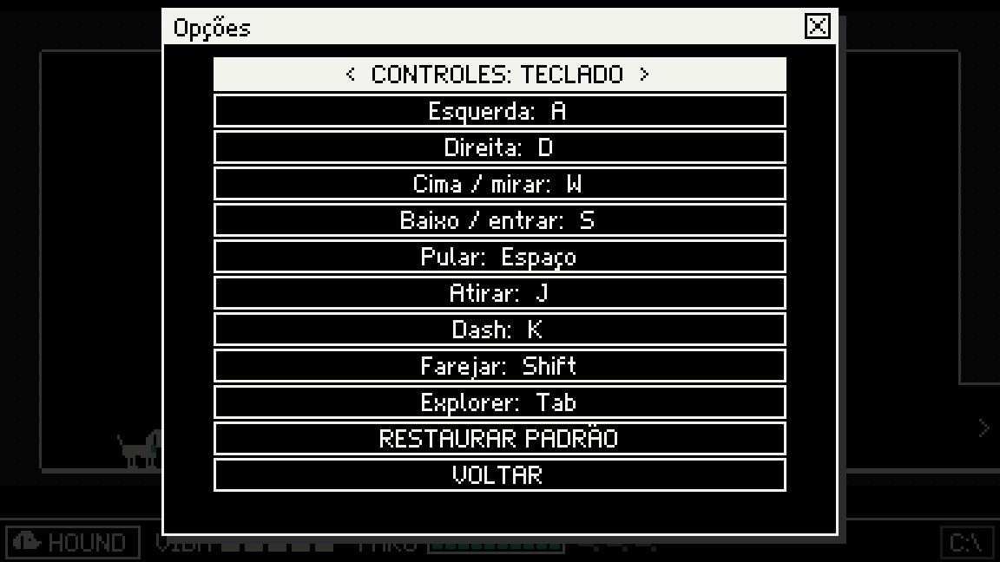
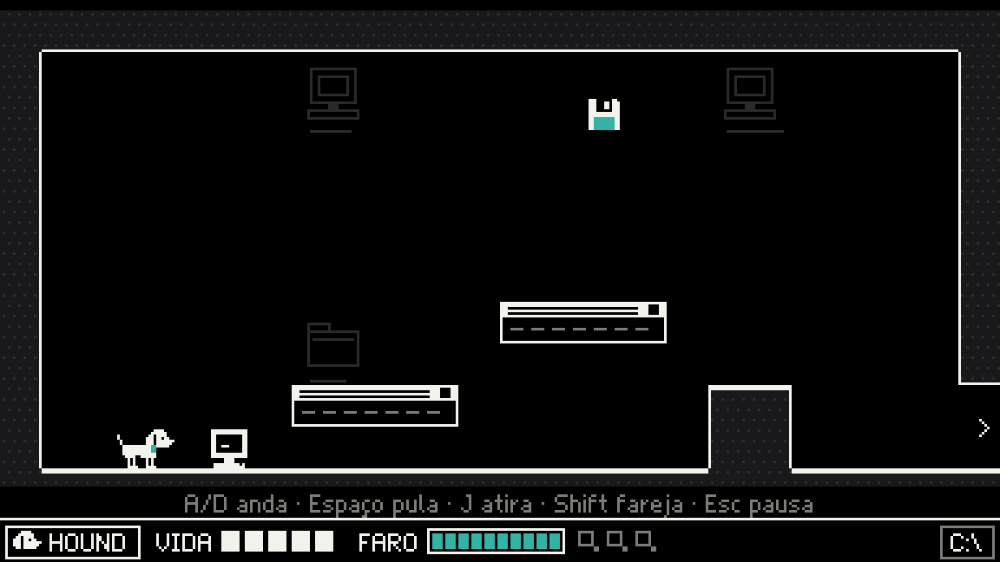

# Hound.exe

[English](README.md) · **Português**

Metroidvania de ação em pixel art 1-bit com o cão do
[scopehound](https://github.com/saulofilho/scopehound). Nome provisório.

- Design: [docs/GDD.md](docs/GDD.md)
- Moodboard: [docs/moodboard.html](docs/moodboard.html)

## A demo: região Área de trabalho (0.2.1)

Onze salas em três alas. A porta no fim da Lixeira exige **três pistas
enterradas**, que só o faro mostra, e cada ala termina em uma.

| Ala | O que ensina | No fim |
|---|---|---|
| Imagens, Galeria | arquivos ocultos: plataformas que existem por 7 segundos depois de farejadas | quarentena, pista |
| Temp, Setup | plataformas temporárias sobre setor ruim | quarentena, chip de dash, pista |
| System32, Drivers | vãos e lasers que pedem o dash | quarentena, pista |

- **Quarentenas** trancam o cão com ondas de bugs, entre eles o **Spam**, um
  envelope com asas que treme, mostra a linha e mergulha. Vencer uma abre o
  atalho de volta.
- **Pastas** são portas: aperte para baixo na frente de uma.
- **Setor ruim** tira 1 de vida e devolve o cão ao chão firme.
- **Backups secretos**, um por sala de exploração (10), deixam o faro mais longo.
- **Controles remapeáveis**, teclado e gamepad, em OPÇÕES > CONTROLES.
- **A porta é um ponto de volta:** morrer na sala de cima ou no chefe devolve
  à Lixeira, não ao pé de Drivers.
- **A tela de fim mostra o tempo**, as mortes e os segredos.

Um bot que conhece o caminho termina, com todos os segredos e todos os bugs
vivos, em cerca de 5 minutos e meio. A duração para quem joga pela primeira vez (meta: 15 a 20)
ainda não foi medida com pessoas.

| Arquivos ocultos | Plataformas temporárias |
|---|---|
|  |  |
| **Quarentena** | **Pastas** |
|  |  |
| **Remapeamento** | |
|  | |

A arte é 1-bit, com teal como cor da região, HUD estilo Windows 95 e fonte
pixel própria com acentos, tudo gerado por `tools/make_art.py`.



O jogo abre na tela de título, salva sozinho e pausa com Esc (ou Start).
Ao continuar, o cão volta ao último ponto de restauração.
A música e os efeitos são originais (`tools/make_audio.py`); volume, idioma
(português ou inglês), tela cheia, tremor e controles ficam em OPÇÕES, no título e na pausa.

O faro é obrigatório: a parede falsa só abre farejada e, na segunda fase do
chefe, só ele acerta o original. Na sala de cima, quem fica parado perde.

**Fase 2 (Steam):** `tools/build.sh` exporta Windows, Linux e macOS e
`tools/make_promo.sh` gera o vídeo de divulgação em inglês. O que está
pronto e o que falta para publicar está em [steam/PUBLICAR.md](steam/PUBLICAR.md).

Depois de clonar, importe uma vez antes de rodar:
`godot --headless --path . --import`.

### Como rodar

1. Instale o Godot 4.7.2: `brew install --cask godot`
2. Abra o Godot, clique em **Importar** e escolha o `project.godot` desta pasta.
3. Aperte **F5**.

| Ação | Teclado | Controle |
|---|---|---|
| Mover | A/D ou setas | analógico esquerdo |
| Entrar numa pasta | S ou seta para baixo | analógico ou direcional para baixo |
| Mirar para cima | W (com A/D: diagonal) | analógico para cima |
| Pular | Espaço ou Z | A |
| Atirar (segurar) | J ou X | X |
| Dash | K ou C | B |
| Farejar (segurar) | Shift ou L | gatilho esquerdo |
| Explorer | Tab | View |
| Pausar | Esc | Start |
| Voltar ao ponto de restauração | segurar R (um toque na tela azul) | menu de pausa |

### Site

<https://saulofilho.github.io/hound-exe/>, em inglês, sai da raiz da `main` pelo
GitHub Pages: `index.html`, `404.html` e `site/`. O `_config.yml` tira código,
GDD e guia de publicação desse endereço. Depois de mudar arte, capturas da loja
ou vídeo de divulgação, rode `python3 tools/make_site.py`.

### Pendências da Steam

- [ ] **Adiado:** regerar o trailer com 5.000 kbps ou mais (hoje tem 1.452).
- [ ] Decidir se o repositório fica público antes de vender.
- [ ] Pôr o botão de wishlist no site quando a página existir.

A lista completa está em [steam/PUBLICAR.md](steam/PUBLICAR.md).

### Playtest

O save conta tempo, mortes e desistências por sala. Não identifica ninguém e o
jogo não envia nada: o testador manda o `save.json` e
`python3 tools/playtest_report.py saves/` faz a conta. O passo a passo está em
[docs/PLAYTEST.md](docs/PLAYTEST.md).

### Testes

`python3 tools/run_tests.py` roda todos (uns 6 minutos) numa pasta de usuário
descartável. O GitHub Actions roda o mesmo em Windows e Linux e confere que os
builds abrem neles.

Depois de mexer nas salas:

```bash
python3 tools/check_rooms.py
godot --headless --fixed-fps 60 --path . -s tests/campaign.gd
```

O primeiro prova, nos mapas, que o caminho existe, que o atalho não existe e
que nenhuma sala prende o cão. O segundo joga do jogo novo até o fim só com os
controles (com todos os bugs, quarentenas, sala de cima e chefe). A lista
completa de testes está no [README em inglês](README.md#tests-and-tools).

### Estrutura

```
project.godot     configuração (384×216, escala inteira, pixel nítido)
title.tscn        título (o jogo abre aqui)
main.tscn         sala lateral
arena.tscn        sala de cima
scripts/
├── rooms.gd      mapas ASCII da região
├── main.gd       monta a sala: saídas, pastas, pistas, perigos, porta
├── player.gd     o cão
├── controls.gd   teclas e botões remapeáveis
├── texts.gd      todo texto, em português e inglês
└── ...           descritos no README em inglês
tests/            testes
tools/            arte, áudio, verificador de salas, capturas, vídeos, builds
steam/            artes, textos e guia de publicação
```

Para mudar as salas, edite `scripts/rooms.gd`; a legenda está no topo dele.
